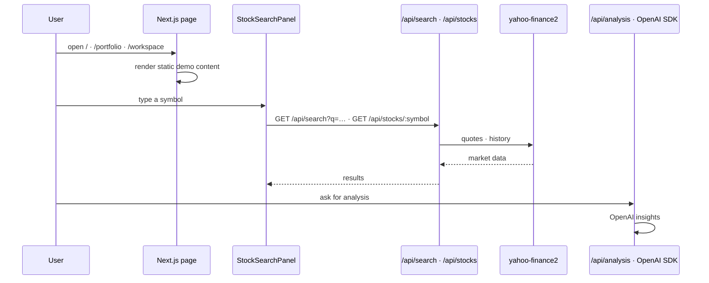
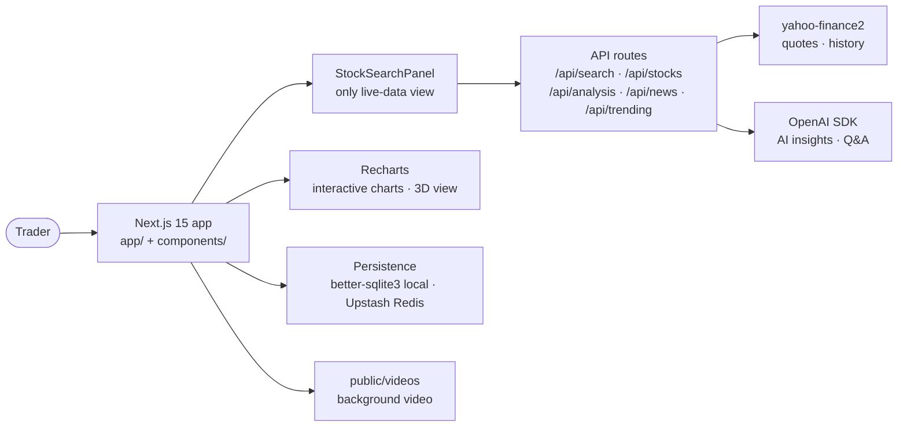

# Stocksense-AI

An **AI assistant for trading** — market data, AI-driven insights and interactive charts in one Next.js app.

**Live demo:** https://stocksense-ai-thiteswapnil1212-hues-projects.vercel.app/

## What it does

- **Dashboard** (`/`) — market overview: index cards (NIFTY 50, S&P 500, NASDAQ, BTC), intraday trend, AI analysis panel, portfolio snapshot, recent signals
- **Portfolio** (`/portfolio`) — holdings, performance vs benchmark, snapshot
- **Workspace** (`/workspace`) — side-by-side stock comparison (e.g. NVDA vs AMD): strength scores, volatility overlay, comparison snapshot, terminal
- **Stock search** — live lookup by symbol — the only view that fetches live data (see Honest limits)
- **API routes** — quotes, history, analysis, news, search, trending

## How it works





## API

| Route | What it does |
|---|---|
| `GET /api/search?q=…` | Symbol search |
| `GET /api/stocks/:symbol` | Quote + history (yahoo-finance2) |
| `GET /api/analysis/:symbol` | AI analysis (OpenAI SDK) |
| `GET /api/news` | Market news |
| `GET /api/trending` | Trending tickers |

## Honest limits — read this first

- **Dashboard, Portfolio and Workspace show static demo data.** Their numbers are hardcoded in the components (`components/DashboardPreview.tsx`, `components/PortfolioTerminalScreen.tsx`, `components/WorkspaceScreen.tsx` — no `fetch`, no `useEffect`). The "LIVE" badges on the dashboard do not mean live data.
- **Only stock search fetches live data** (`components/StockSearchPanel.tsx` → `/api/search`, `/api/stocks` → yahoo-finance2).
- **AI features need keys.** No API keys are configured on the Vercel deployment, so OpenAI/Upstash-backed features don't work on the live demo. Set OpenAI + Upstash keys in `.env.local` locally (there is no `.env.example` in the repo) or in the Vercel dashboard.
- **Dashboard layout defect** (seen 2026-11-20 at 1919×998): cards overlap and clip each other, and the fixed AI Copilot bar covers the chart and the signals table.
- **Dead navigation.** Sidebar items Market Overview, Watchlist, AI Analyst, Research Reports and Settings only highlight — they don't navigate. Only Dashboard, Portfolio and Workspace are real routes.
- **Portfolio Snapshot shows N/A** for Value, P&L and This week, and Headlines is empty, on the live demo (seen 2026-11-20).
- **Repo is 111 MB because of two videos.** `public/videos/` holds `hero-bg.mp4` (~30 MB) and `market.mp4` (~79 MB), used as background video. The code itself is small.

## Tech stack

| Layer | Choice |
|---|---|
| Framework | Next.js 15.2.6 (App Router) · React 19 · TypeScript |
| Styling | Tailwind CSS v3 · Framer Motion · lucide-react |
| Market data | yahoo-finance2 |
| AI | OpenAI SDK |
| Charts | Recharts · @react-three/fiber + @react-three/drei (3D view) |
| Persistence | better-sqlite3 (local) · Upstash Redis (shared state) |
| Validation | Zod / Yup |

Next.js was patched 15.2.3 → 15.2.6 because Vercel blocks 15.2.3 (CVE-2025-66478, React2Shell).

## Project structure

```text
app/                Pages (/, /portfolio, /workspace) + API routes (analysis, news, search, stocks, trending)
components/         AppShell, DashboardPreview, PortfolioTerminalScreen, WorkspaceScreen,
                    StockSearchPanel, StockSenseDashboard (3D), VideoBackground, ...
public/videos/      hero-bg.mp4, market.mp4 (~110 MB — see Honest limits)
```

## Getting started

```bash
npm install
npm run dev      # http://localhost:3000
npm run build
```

Configure API keys (OpenAI, Upstash) in `.env.local` before running — there is no `.env.example` in the repo.

## Disclaimer

Educational project — not financial advice. Market data may be delayed; verify before making decisions.
