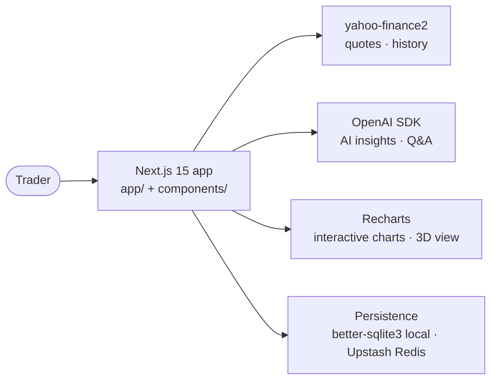

# Stocksense-AI

An **AI assistant for trading** — market data, AI-driven insights and interactive charts in one Next.js app.

Live demo: https://stocksense-ai-thiteswapnil1212-hues-projects.vercel.app/

## What it does

- **Market data** via `yahoo-finance2` (quotes, history)
- **AI assistance** via the OpenAI SDK — ask questions about stocks and strategies
- **Interactive charts** with Recharts
- **Persistence** — `better-sqlite3` locally, Upstash Redis for shared state
- **Validated inputs** with Zod/Yup, animated UI with Framer Motion

## Tech stack

Next.js 15 · React 19 · TypeScript · Tailwind CSS v3 · OpenAI SDK · yahoo-finance2 · Recharts · better-sqlite3 · Upstash Redis · Zod/Yup · Framer Motion

## Getting started

```bash
npm install
npm run dev      # http://localhost:3000
npm run build
```

Configure API keys (OpenAI, Upstash) in `.env.local` before running.

## Architecture



## Disclaimer

Educational project — not financial advice. Market data may be delayed; verify before making decisions.
